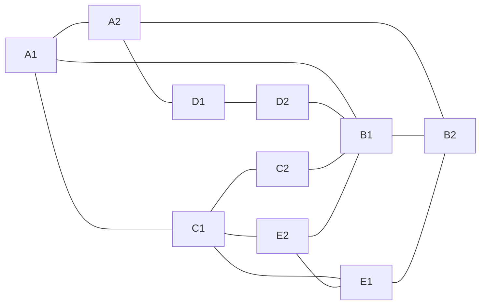

# WAN CI/CD Automation: Topology

10 WAN nodes (all IOSv), 15 links.
Nodes: A1, A2, B1, B2, C1, C2, D1, D2, E1, E2.

## Link table

| # | Endpoint 1 | Endpoint 2 |
|---|---|---|
| 1 | WAN-A1 | WAN-A2 |
| 2 | WAN-A1 | WAN-B1 |
| 3 | WAN-A1 | WAN-C1 |
| 4 | WAN-A2 | WAN-B2 |
| 5 | WAN-B1 | WAN-B2 |
| 6 | WAN-A2 | WAN-D1 |
| 7 | WAN-D1 | WAN-D2 |
| 8 | WAN-D2 | WAN-B1 |
| 9 | WAN-C1 | WAN-C2 |
| 10 | WAN-C2 | WAN-B1 |
| 11 | WAN-C1 | WAN-E1 |
| 12 | WAN-E1 | WAN-B2 |
| 13 | WAN-C1 | WAN-E2 |
| 14 | WAN-E2 | WAN-E1 |
| 15 | WAN-E2 | WAN-B1 |
